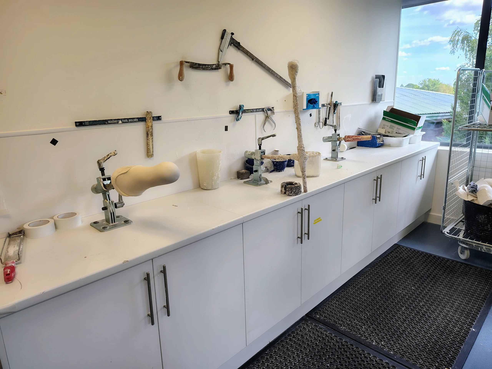
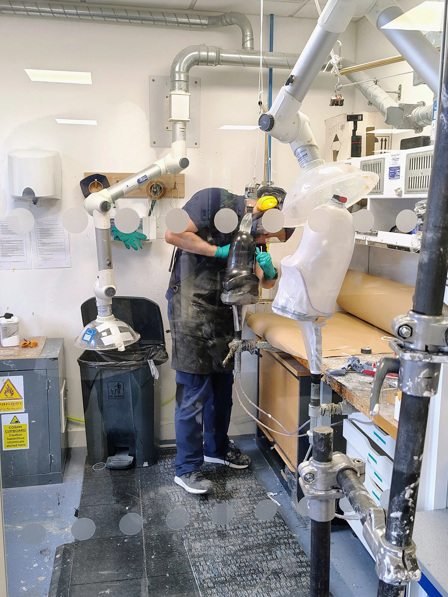

  <header class="itinerary-story__intro">
    
Germany &middot; Designed for Living

    <h2>Prosthetic Care in Germany</h2>
    
Germany Intro

    <aside class="itinerary-story__note" aria-label="Field note">
      
<strong>Field Note</strong>

      
<em>This account reflects my own observations and interpretations as an independent observer. It does not represent the views, opinions, or positions of Ottobock Care, Humanity & Inclusion, or their employees. Any statements or perspectives attributed to individuals I spoke with are presented as I understood them from our conversations and should not be interpreted as official statements on behalf of the organizations. Names of the people I met have been omitted. This account has not been reviewed or endorsed by Ottobock or Humanity & Inclusion.</em>

    </aside>
    <nav class="itinerary-story__index itinerary-story__visit-index" aria-label="Germany experiences" data-itinerary-visit-nav>
      <a class="is-active" href="#ottobock-international">Ottobock am Standort Bötzow</a>
      <a href="#HI-meeting">Humanity & Inclusion</a>
    </nav>
    

      <section class="itinerary-story__visit-profile" id="ottobock-international" data-itinerary-visit="ottobock">
        <dl class="itinerary-story__facts">
          
<dt>Organization</dt><dd>Ottobock Care</dd>

          
<dt>City</dt><dd>Berlin (virtual conversation)</dd>

          
<dt>Scope</dt><dd>Domestic & international patient care</dd>

          
<dt>Date called</dt><dd>October 1, 2026</dd>

        </dl>
      </section>
      <section class="itinerary-story__visit-profile" id="HI-meeting" data-itinerary-visit="HI" hidden>
        <dl class="itinerary-story__facts">
          
<dt>Organization</dt><dd>Humanity & Inclusion</dd>

          
<dt>City</dt><dd>Berlin (virtual conversation)</dd>

          
<dt>Scope</dt><dd>???</dd>

          
<dt>Date called</dt><dd>October ?, 2026</dd>

        </dl>
      </section>
    

  </header>

  

    <section class="itinerary-story__section itinerary-story__section--opening">
      

      <h2>Subtitle 1</h2>
      

        paragraph 1
      

    </section>
    <section class="itinerary-story__section">
      

      <h2>A Clinic That Does It All</h2>
      

        The first thing that surprised me was the size of the building. The clinic where I had interned in Kentucky had only a consultation room and a workshop. The prosthetist made plaster models and assembled and adjusted limbs in the workshop, but sent models to central fabrication facilities in Ohio and Tennessee for the check and definitive sockets. That arrangement kept the workshop smaller while also adding shipping time between stages.
      

      

        At Amersham, both check sockets and definitive sockets were fabricated in-house. Alongside consultation rooms and a physiotherapy gym, the clinic had spaces for plaster work, model rectification, and socket fabrication. Rectification is the process of modifying a model to guide the socket’s fit. Seeing the workspaces helped me understand why incorporating fabrication into a clinic changes both its footprint and the way people work within it.
      

    <figure class="itinerary-story__body-copy">
      
      <figcaption>Plaster models and work surfaces in the clinic’s fabrication area. The work of refining fit begins before the finished socket reaches the patient.
        Photo: author, Dorset Orthopaedic, Amersham.
      </figcaption>
    </figure>
     

      

        A prosthetist talked me through the fitting process. As at the clinic in Kentucky, the team might work through two or three transparent check sockets while refining a patient’s fit. These temporary sockets allow clinicians to assess contact and comfort before making a costly definitive version. He explained that patients using them outside the clinic needed close review, often weekly, because the durability of the material can vary depending on the person’s weight and how they use the limb. In some cases, the team reinforced a check socket with carbon fiber for extra support. I had seen fiberglass reinforcement before, but carbon fiber reinforcement was new to me.
      

      

        With a workshop in-house, I was curious if the team could cast someone in the morning and give them their check socket that afternoon. This way, the person could be cast and start walking on a temporary socket all in one day, rather than needing to schedule a follow-up appointment to receive their socket. The prosthetist said it was possible, although unusual and generally reserved for urgent circumstances. It was not the normal timetable, but having that option can matter a lot.
      

      

        In Kentucky, I had met patients who traveled more than three hours each way for care. Consultation, casting, fitting, and adjustments could mean several journeys to the clinic and back before a limb was ready for regular use. An appointment’s cost often includes time away from work and transport. Combining stages, such as casting and check socket fabrication, cannot remove the need to check fit carefully, but it can reduce part of the burden of scheduling multiple appointments. Because of this, I began to think of fabrication capacity as an access issue as well as a manufacturing decision.
      

    <figure class="itinerary-story__body-copy">
      
      <figcaption>The in-house workshop supports the steps between an initial model and a finished socket.
        Photo: author, Dorset Orthopaedic, Amersham.
      </figcaption>
    </figure>
      

    </section>
    <section class="itinerary-story__section">
      

      <h2>Who Can Reach This Kind of Care?</h2>
      

        Seeing the workshop and rehabilitation spaces made the difference in funding tangible. A clinic may have the equipment and expertise to offer extensive care, but a patient still needs a way to pay for it. For someone with a personal injury claim, a case manager may help coordinate that process. Dorset’s <a href="https://www.dorset-ortho.com/offer/information-for-defendant-insurers" target="_blank" rel="noopener noreferrer">published referral pathway</a> describes clinical assessment, recommendations, reporting to insurers, and follow-up. This is a different route from relying on an ordinary private medical insurance policy to cover a prosthesis.
      

      

        The team described an assessment as a way to understand the person’s life before deciding what services to provide. Work, hobbies, confidence, and the effects of the injury could all shape a plan, including recommendations for physiotherapy, occupational therapy, or psychological support. My understanding was that the clinic and case manager stay in communication as needs change. Receiving a leg is one stage in that process, though it does not necessarily mark the end of rehabilitation.
      

      

        I asked whether maintaining relationships with established patients eventually overwhelmed a clinic that also accepted new referrals. The prosthetist described a changing rhythm of care in which appointments might be weekly during early fitting and rehabilitation, then fortnightly as the fit and the patient’s confidence improved. Once someone was comfortable using a definitive prosthesis, reviews could become six-monthly or annual, with additional visits when adjustments were needed. The pattern he described was not a fixed timetable for every patient, but it does highlight how keeping someone under the clinic’s care does not mean continuing the intensity of those first few months indefinitely.
      

      

        People might also choose a clinic because of an established relationship rather than simply its distance from home. A team that already understands their history, goals, and prosthetic device could be worth traveling farther to see. Conversely, someone might seek ongoing adjustments closer to home once their initial rehabilitation is complete. This helped me understand that access was about both geography and continuity because the nearest clinic is not necessarily the one a person feels best understands their needs.
      

      

    </section>
    <section class="itinerary-story__section">
      

      <h2>The Freedom to Prescribe</h2>
      

        The physiotherapist told me that although Dorset is part of Ottobock Care, clinicians retain freedom of prescription. In other words, they can recommend components from other manufacturers when those better meet a patient’s needs. That distinction matters because the company that owns a clinic and the clinician choosing a component have different responsibilities and different priorities.
      

      

        Public funding does not always mean that the NHS directly employs the prosthetic team. Some NHS services are delivered by contracted private companies, which may provide prosthetics, orthotics, or both. The patient still receives NHS-funded care, but the company running the service can change if the contract is awarded to a different provider. If that company also manufactures components, it may be both the employer of the clinician choosing a device and the business that benefits from its sale. That overlap makes freedom of prescription especially important.
      

      

        One clinician described how this had played out in a previous NHS-contracted service. Under the original provider, they had been able to prescribe components from different manufacturers. When another company took over the contract, that freedom initially remained. Gradually, however, the new provider began questioning choices outside its own product range. Clinicians then had to complete a form justifying each outside component. According to the clinician, those additional requirements eventually became a directive to prescribe the company’s own products. What began as an administrative change had eventually narrowed the choices they could offer patients.
      

      

        The clinician told me that this loss of prescribing freedom was a reason for leaving that role. I was particularly fascinated by how a clinician could remain in the same service while the rules governing their decisions changed around them. If a component from another manufacturer better suited a patient, clinical judgment alone might no longer be enough to make it available.
      

      

        Choice alone does not settle whether a recommendation for a specific device is appropriate. The physiotherapist described using rehabilitation trials and evidence of benefit to support decisions, particularly when considering a more complex or expensive component. A trial involves giving the patient an opportunity to use a proposed component, with fitting and rehabilitation support, before committing to it. The prosthetist can adjust the setup while the physiotherapist helps the person learn how to use it. That gives the team a chance to distinguish an unsuitable device from one the patient simply has not yet learned to use.
      

      

        The question is then whether the component offers a meaningful improvement for that person. Does it help with the movements they find difficult? Can they use its features comfortably and consistently? Does the benefit justify choosing it over a simpler option? These are the kinds of questions a supported trial can help answer. As I understood the physiotherapist’s explanation, the team needed to demonstrate why a recommendation made sense, rather than assume that more features meant better care. Having both a prosthetist and physiotherapist involved also meant the decision could draw on what happened during rehabilitation as well as what happened at the fitting appointment.
      

      

        A member of the healthcare operations team at the clinic added another perspective. Having begun work at Dorset Orthopaedic prior to its acquisition by Ottobock in 2014, she described how joining the Ottobock Care network expanded the support around the clinic. HR, IT, marketing, and shared administrative systems became part of a much larger operation. In her account, the excellent clinical work downstairs did not change much, while the management and administration upstairs changed substantially. The clinic also gained access to a wider network of colleagues and resources.
      

      

        Her earlier experience with Ministry of Defence-related work showed another side of how services are organized. She described contracts in which bidders needed to show more than their ability to manage 
This page will be updated following my visit to Germany, where I'll explore the largest medical device market in Europe.
